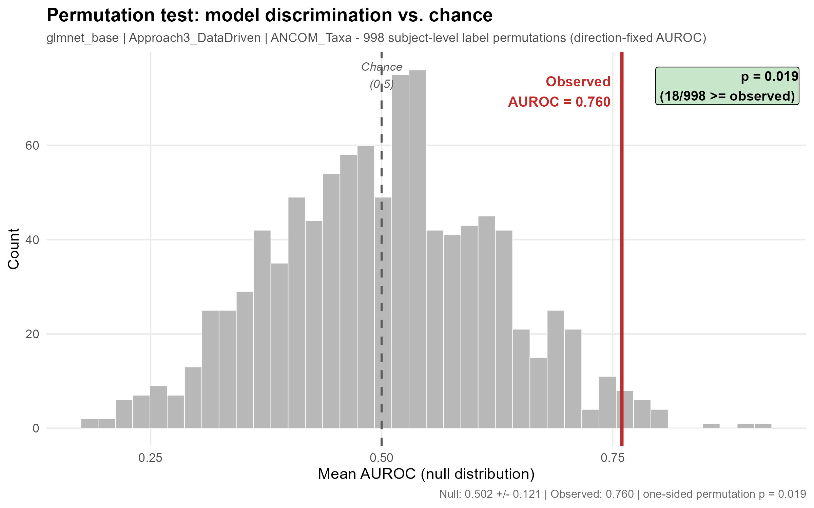

# Permutation test — saved artefacts

This directory holds two permutation tests:

1. **[Updated test across the 18 combinations](#updated-test-across-the-18-combinations-specified-before-running)**
   (October 2026) — its design and how its result will be read were written down here
   *before* the permutations were run. Results will be added to that section when the null
   distribution is complete.
2. **[Previous test, single model](#previous-test-single-model-august-2026)** (August 2026) — the
   saved files listed further down. It predates the methodological updates of September–October
   2026 and is kept for the record.

## Updated test across the 18 combinations (specified before running)

> 📌 **Status (2026-10-19): running.** Everything in this section was written before any
> permuted result was seen. The numbers below are the observed values the test is run against.

### Why the test is repeated

- **The reported model changed.** After the methodological updates (fixed-orientation AUROC,
  clinical variables restricted to those available at the visit, and the updated education
  indicator; see [`docs/CLINICAL_AVAILABILITY_RESULTS.md`](../../docs/CLINICAL_AVAILABILITY_RESULTS.md)
  and [`docs/SOCIOECONOMIC_INDICATORS.md`](../../docs/SOCIOECONOMIC_INDICATORS.md)), the
  elastic net · Approach 3 · ANCOM-BC2 taxa model has a cross-validated AUROC of **0.738 ± 0.270**,
  not the 0.760 tested in August.
- **The comparison now spans 18 combinations.** The 12 combinations with microbiome were joined by
  6 clinical-only ones ([`docs/CLINICAL_ONLY_ARM.md`](../../docs/CLINICAL_ONLY_ARM.md)), and the
  highest AUROC of the 18 belongs to a clinical-only model (**0.802 ± 0.233**). Testing only the
  combination that ends up on top after looking at all 18 overstates the evidence: the best of 18
  is expected to be high even when there is no signal. The updated test therefore compares the
  observed values with the **best of 18 under shuffled labels**.

### Design

| | |
|---|---|
| Null hypothesis | Preterm status is unrelated to every predictor (clinical and microbiome): the labels are exchangeable across participants. |
| What is shuffled | Preterm status, **at participant level** (all samples of a participant keep a single label). The same shuffle is carried to every copy of the label the pipeline reads: the model outcome in the three clinical sets, the subject table used to stratify the inner 70/30 split, and the sample metadata ANCOM-BC2 receives. |
| What is re-run in every permutation | The whole selection and fitting procedure for **all 18 combinations**: the Approach 3 per-fold screening, ANCOM-BC2 per fold, the inner split, the threshold and the model fit. The outer folds are kept fixed (the same participants in each test fold as in the observed run); a test fold left with a single class after shuffling has no AUROC and is skipped, as in the previous test. |
| Statistic per combination | Mean fixed-orientation AUROC across the outer folds — the value the pipeline reports. |
| Test statistic | The **maximum over the 18 combinations** in each permutation. |
| Observed values | Maximum of the 18: **0.802** (elastic net · Approach 3 · clinical only). Main model: **0.738** (elastic net · Approach 3 · ANCOM-BC2 taxa). |
| Permutations | **199**, seeds 20001–20199 (a separate range from the previous test). The smallest p-value 199 permutations can give is 1/200 = 0.005; near 0.05 the Monte Carlo standard error of the p-value is about 0.015, and the p-values are reported with their Monte Carlo 95% interval. |
| p-value | One-sided, (b + 1)/(m + 1) (Phipson & Smyth, 2010), where b counts the permutations whose maximum of 18 is at least the observed value and m the permutations with a result. |
| Threshold | 0.05, applied to the selection-adjusted p-values below. |

Two selection-adjusted p-values come out of the same run:

- **Best of the 18** (elastic net · Approach 3 · clinical only, 0.802): permutations whose maximum
  of 18 reaches 0.802. This is the primary result.
- **Main model** (elastic net · Approach 3 · ANCOM-BC2 taxa, 0.738): permutations whose maximum of
  18 reaches 0.738.

Each combination's own unadjusted p-value (its observed AUROC against its own null) is also
reported, for reference only; no conclusion is drawn from it.

### How the result will be read

**If p ≤ 0.05.** Choosing the best of 18 combinations with shuffled labels rarely reaches the
observed value, so the cohort data carry discrimination above chance even after accounting for
having picked the best of 18. The same reading applies to the main model if its own adjusted
p-value is also ≤ 0.05. A result at this level does **not** show:

- *that the microbiome contributes.* The test asks whether there is signal in the predictors as a
  whole, and the best combination uses no microbiome at all. Whether adding the microbiome changes
  discrimination is answered by the paired comparison in
  [`docs/CLINICAL_ONLY_ARM.md`](../../docs/CLINICAL_ONLY_ARM.md), not here.
- *how strong the discrimination is, or that it carries over to other cohorts.* The cross-validated
  AUROCs and their fold-to-fold spread (± 0.23–0.27 for these two models) remain the estimates; the
  permutation test only places them against chance.
- *that the signal is biological.* Shuffling breaks every association with the outcome, including
  the one that comes from how samples were collected (participants who delivered preterm
  contributed fewer samples; see [`docs/SAMPLE_COUNT_REFERENCE.md`](../../docs/SAMPLE_COUNT_REFERENCE.md)).
  A small p-value is compatible with signal of that origin.

**If p > 0.05.** The best AUROC of the 18 lies within the range that the best of 18 reaches with
shuffled labels. It will be reported that, once the choice among 18 combinations is accounted for,
the data do not show discrimination distinguishable from chance at the 5% level; the AUROCs remain
the cross-validated estimates, but they are not presented as evidence that the models predict
preterm birth. This is not evidence that there is no association: with 43 participants (14
preterm) and 5 outer folds the test has limited power. The previous p = 0.019 (below) is
superseded in either case, because it tested a single model chosen among the combinations and was
computed before the updates.

**If the two adjusted p-values fall on different sides of 0.05** (best of 18 ≤ 0.05, main model
> 0.05), signal above chance is reported for the clinical-only model only, and not for the model
that includes the microbiome.

## Previous test, single model (August 2026)

> 📌 This test predates the methodological updates of September–October 2026 and is superseded by
> the updated test above. Its files are kept unchanged for the record.

These files are the **saved output of the permutation test** for the model reported in
[`docs/UPDATE_SINCE_PUBLICATION.md`](../../docs/UPDATE_SINCE_PUBLICATION.md):

> **Elastic net (glmnet) · Approach 3 (data-driven) · ANCOM-BC2-selected taxa**

They are versioned deliberately. Regenerating the null distribution takes **≈3.6 hours on 8
cores**, so having the result in the repository lets a reader check the p-value, the shape of
the null and the per-fold numbers without re-running anything — and without installing R, in
the case of the figure.

### Result

| | Value |
|---|---|
| Observed AUROC (5 outer folds, real cohort) | **0.760** |
| Null distribution, 999 subject-level label permutations (998 valid) | **0.502 ± 0.121** (median 0.504, range 0.184–0.913) |
| Permutations reaching the observed value | 18 / 998 |
| **One-sided permutation p-value** | **0.019** |

The null is centred on 0.502 and 48.6% of its mass falls below 0.5, which is the check that
the null is legitimate (a permuted-label AUROC should average 0.5). With the statistic used
previously the same data gave p = 0.139; see
[`docs/UPDATE_SINCE_PUBLICATION.md` §2.4](../../docs/UPDATE_SINCE_PUBLICATION.md) for what changed
and why.



### Files

| File | What it is |
|---|---|
| `permutation_null_final999.png` | Histogram of the null distribution with the observed AUROC and the p-value annotated. Raster version, renders inline on GitHub. |
| `permutation_null_final999.pdf` | The same figure, vector format, for publication. |
| `permutation_summary_final999.csv` | One-row summary: target model/approach/microbiome input, observed AUROC, null mean/SD/median/min/max, `n_permutations` (999), `n_valid` (998), `n_exceeding` (18) and `p_value` (0.019). The final column, `p_value_prior_statistic`, carries 0.139 — the value the automatic-orientation statistic used previously would have reported — kept for comparison. |
| `permutation_null_final999.csv` | The null distribution as plain text: 999 rows with `permutation`, `seed`, `auroc_fixed` (fixed-orientation AUROC, the statistic used), `auroc_auto` (automatic-orientation AUROC, kept for comparison) and `n_folds_valid`. |
| `perm_null_final999.rds` | The raw R object behind the two CSVs: the 999 null values (fixed and automatic orientation), valid folds per permutation, the seeds, the wall-clock runtime, and the observed run embedded for reference. |
| `perm_observed.rds` | The unpermuted run: observed AUROC (fixed and automatic orientation), per-fold metrics, per-fold fixed-orientation AUROC, and the out-of-fold subject-level predictions. |
| `supplementary_per_fold_metrics.csv` | Per-fold table for the reported model (one row per outer fold): `n_test`, `n_ptb`, `threshold`, `AUROC`, `AUROC_fixed`, `PRAUC`, `Sensitivity`, `Specificity`, `Balanced_Accuracy`, `Youden`. Prepared as a supplementary table in response to reviewer comments. |

### How to regenerate

> 📌 The commands below belong to the version of `scripts/permutation_test.R` that produced these
> files ([`161cee7`](https://github.com/martinruhle/Mexican-PretermBirth-analysis/blob/161cee7/scripts/permutation_test.R)),
> run on the pipeline as it was in August 2026. The current script runs the updated test above.

All three modes are driven by [`scripts/permutation_test.R`](../../scripts/permutation_test.R)
and require the **restricted cohort data** in `data/raw/` (see
[`docs/DATA_ACCESS.md`](../../docs/DATA_ACCESS.md)). Outputs are written to
`analysis/_output/` (untracked scratch); the files here are copies of that output.

```bash
# 1. Observed value + per-fold supplementary table (~40 s)
#    -> perm_observed.rds, supplementary_per_fold_metrics.csv
PTB_PERM_MODE=verify Rscript scripts/permutation_test.R
```

```bash
# 2. Null distribution: 999 permutations, ~3.6 h on 8 cores
#    -> perm_null_final999.rds
PTB_PERM_MODE=run PTB_PERM_N=999 PTB_PERM_CORES=8 PTB_PERM_TAG=final999 Rscript scripts/permutation_test.R
```

```bash
# 3. p-value, summary tables and figure from the saved null (seconds)
#    -> permutation_null_final999.{csv,png,pdf}, permutation_summary_final999.csv
PTB_PERM_MODE=report PTB_PERM_TAG=final999 Rscript scripts/permutation_test.R
```

Step 3 recomputes the p-value, the tables and the figure from `perm_null_final999.rds` rather than
re-running the permutations, so it takes seconds. It still loads the pipeline scaffolding first, so
it needs the cohort data present like the other two modes; copy `perm_null_final999.rds` and
`perm_observed.rds` from this directory into `analysis/_output/` before running it.

The permutation seeds are fixed (`10001`–`10999`), so the null distribution and the p-value
are reproducible; this was confirmed across independent runs.
